# WearMe (VirtualTryOn) — System Architecture

## Overview

WearMe is a modular, production-oriented AI virtual fashion try-on platform built in a TypeScript + Python monorepo.

```mermaid
flowchart TD
    Web["Next.js Web App (apps/web :3000)"]
    API["NestJS API (apps/api :3001)"]
    DB[("PostgreSQL 16 (packages/database :5434)")]
    Storage["StorageProvider Abstraction (Local / S3 / R2 / GCS)"]
    AIService["Python FastAPI Service (apps/ai :8001)"]
    Mock["MockProvider (Deterministic Composite)"]
    Fashn["FASHNApiProvider (https://api.fashn.ai/v1)"]

    Web -->|REST /api/v1| API
    API -->|Prisma ORM| DB
    API -->|Upload / Download / Delete Keys| Storage
    API -->|HTTP Multipart /try-on| AIService
    AIService -->|AI_PROVIDER=mock| Mock
    AIService -->|AI_PROVIDER=fashn-api| Fashn
```

## Monorepo Layout

- `apps/web` — Next.js 16 App Router frontend (TypeScript, Tailwind CSS v4, TanStack Query)
- `apps/api` — NestJS REST backend (TypeScript, Swagger, Multer, Sharp validation, Storage & AI abstractions)
- `apps/ai` — Python 3.11 FastAPI AI inference microservice (`MockProvider` and `FASHNApiProvider`)
- `packages/shared` — Shared TypeScript enums, constants, and API contract types
- `packages/database` — Prisma schema, migrations, and generated client
- `packages/config` — Shared TypeScript configurations (`base.json`, `nestjs.json`, `nextjs.json`)
- `scripts/evaluate_vton.py` — Repeatable 15-case VTON evaluation harness

## Key Architectural Decisions

1. **Storage Keys, Never URLs in Database**: `TryOnJob` stores keys (`jobs/{jobId}/person.jpg`, `jobs/{jobId}/garment.jpg`, `jobs/{jobId}/result.jpg`). Runtime URL resolution is handled by `StorageProvider`, enabling zero-migration transitions from local disk to AWS S3, Cloudflare R2, or GCS.
2. **Decoupled AI Microservice**: NestJS delegates inference over HTTP (`FastApiProvider`) to `apps/ai` (`FastAPI`), keeping Node.js API servers stateless and isolating provider-specific polling, retries, and image encoding inside Python.
3. **Strict Provider Isolation (Zero Silent Mock Fallback)**: When `AI_PROVIDER=fashn-api` is configured, the system never falls back to `MockProvider` on error. Missing credentials, upstream errors, or invalid poses surface clear, user-safe failure states so test overlays are never mistaken for real AI results.
4. **Defense-in-Depth Image Validation & SSRF Protection**:
   - Both NestJS (`sharp`) and FastAPI (`Pillow`) verify MIME type, file signature (magic bytes), structural image decoding, and dimension bounds (`64x64` to `4096x4096`, aspect ratio `1:16` to `16:1`).
   - `FASHNApiProvider` defaults to `return_base64: true` (avoiding 72-hour third-party CDN retention) and enforces an HTTPS host allowlist (`cdn.fashn.ai`, `media.fashn.ai`) when downloading URL outputs.
5. **Privacy & User-Controlled Deletion**: Users can immediately delete their try-on job and all associated stored images (`person`, `garment`, `result`) from the UI via `DELETE /api/v1/try-on/:jobId`, backed by a 7-day `expiresAt` retention window.
